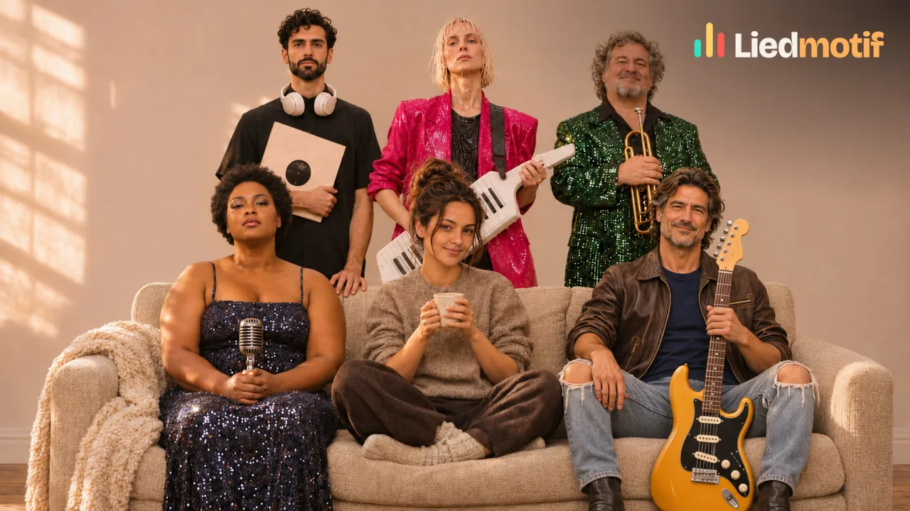
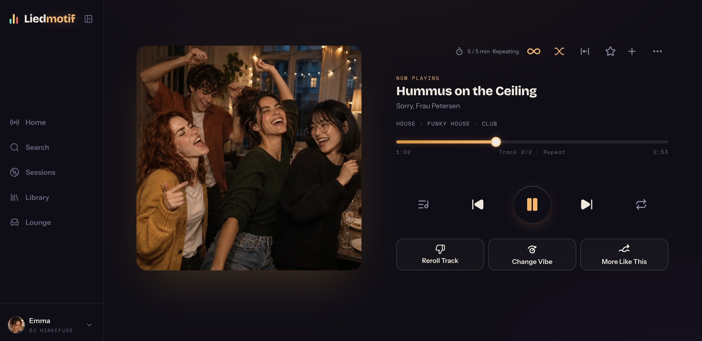

# Liedmotif

> Self-hosted AI music app tailored to your mood and activity.

[](https://liedmotif.com/#what-is-liedmotif)

▶ [Songs about your life, while you're living it.](https://liedmotif.com/#what-is-liedmotif)

Describe what the music is *for*, such as a workout, a coding session, a rainy walk or sleep, and Liedmotif generates a continuous listening session through your own provider API keys. It's your personal streaming app: every track is made for you, from what you ask for and what you choose to tell it about yourself. It runs on your own machine, your library and personal details are stored there, and you can invite family and friends.

**Why "Liedmotif"?** *Lied* is the German word for song. *Leitmotif* comes from the German *Leitmotiv*, "leading motif": the musical theme that follows a character through an opera or a film. Liedmotif gives you both: songs made for the moments of your life.



[Website](https://liedmotif.com) · [Documentation](https://liedmotif.com/docs/) · [All features](https://liedmotif.com/docs/features/)

## Features

- **Sessions from a sentence.** Describe what you want, then fine-tune genre, energy, vocals, voice and language. Music is instrumental by default. Vocals are optional and can be sung in your own recorded voice, with synced lyrics.
- **Tailored to you, privately.** Add your profile and the people in your life, and songs and covers can really be about them. Surprise Me picks from the taste it has learned. All of this is stored on your own machine, and there is no Liedmotif service that could see it.
- **Continuous, blended playback.** A session keeps generating ahead of you, or loops the tracks it already has at no cost. Tracks crossfade like a DJ set, beat-matched when they allow it, at even loudness.
- **Simple steering.** Change Vibe re-styles the running session, More Like This starts a new one from a track, and Dislike swaps a track for another in the same vibe. There is no Like button: if you keep listening, that's the signal.
- **A library you keep.** Playlists, Favorites, smart lists, listening history, resumable sessions and one search across all of it. Tracks can be stored on your phone for the Offline Library.
- **Made for your phone.** Mobile-first interface with lock-screen controls.
- **Family and friends.** Invite people with a one-time link. Each gets a private space and generates through your keys within a budget you set. You see their usage, never their music.
- **Bounded costs.** Concurrency and queue limits always apply, and every invited person has a budget. Your own daily and monthly caps are optional and offered during setup. A session that hits a limit loops its own tracks instead of stopping.
- **Scheduled backups.** Rotated, encrypted backups with a one-command restore.

## Meet Roadie

[](https://liedmotif.com/#roadie)

▶ [Every star has a Roadie. Meet yours.](https://liedmotif.com/#roadie)

Roadie is the AI assistant inside the app. Ask how something works, or say what you want done: "play my running playlist", "favorite this", "start something calm for reading". Anything that generates new music comes back as a card, and nothing is made until you confirm it. Roadie is laid-back and a little snippy by default, and you can give it a tone of your own. It needs the optional text LLM key. [More about Roadie](https://liedmotif.com/docs/features/#ask-roadie).

## Good To Know

- Provider keys stay on the server and never reach the browser. Keys entered in the app are encrypted at rest. Keys placed in `.env` are stored as plain text on that machine.
- The providers you connect receive what each request needs. Your name, city and the details of people you name can go to a text LLM, and reference photos to the image provider. Without those two services, or with a local Ollama, your profile text stays on your machine. [Privacy and security](https://liedmotif.com/docs/privacy-and-security/) lists what each provider sees.
- Your rights to generated music depend on your provider and your plan with them. Liedmotif makes no copyright-safety promise.
- Direct artist imitation is not offered as a first-class workflow.
- Liedmotif is self-hosted and used at your own risk.

## What You Need

- **A machine.** Any 64-bit Linux computer with 4 GB of RAM or more for an always-on install, such as a Raspberry Pi 4 or 5, a mini PC or a rented server. To try it on a Mac, Windows or Linux computer, you need Docker Desktop, or Docker Engine 28+ with Compose 2.24+.
- **A music provider key (required).** Liedmotif uses a Suno-compatible API, a third-party service. A suno.com account or subscription does not work. You pay the provider directly, currently about 4 cents per track, or about $0.70 for an hour of new music. Replaying tracks you already have costs nothing.
- **A text LLM key (optional).** OpenAI, OpenRouter, any OpenAI-compatible endpoint, or Ollama expands your request into a detailed musical direction and names your sessions. Without one, your words reach the music model as written.
- **An OpenRouter key (optional)** for generated covers, about 7 cents each. Every session gets a free cover without one.

## Install

### Local Install

On a Mac, Windows or Linux computer with Docker, run:

```bash
git clone https://github.com/bergie81/liedmotif.git liedmotif
cd liedmotif
cp .env.example .env
cat >> .env <<EOF
APP_SECRET=$(openssl rand -base64 32)
BETTER_AUTH_SECRET=$(openssl rand -base64 32)
CREDENTIAL_ENCRYPTION_KEY=$(openssl rand -base64 32)
BACKUP_ENCRYPTION_PASSPHRASE=$(openssl rand -base64 32)
EOF
docker compose up -d --build
```

Generate the secrets only once, because they protect your saved provider keys and backups. Keep a copy of `.env` somewhere safe.

Open `http://localhost:2206`, create the admin account, and enter your provider keys during guided setup. Only this computer can reach the app. To update, run `git pull` and `docker compose up -d --build`. To serve a domain or LAN address from source, see [running in production](INSTRUCTIONS.md#running-in-production-docker-compose).

### Home Server Or Cloud

On a 64-bit Debian, Ubuntu or Raspberry Pi OS machine, run:

```bash
curl -fsSL https://github.com/bergie81/liedmotif/releases/latest/download/install.sh | bash
```

The installer adds Docker and Tailscale if they are missing, generates every secret, installs to `/opt/liedmotif`, and asks for `sudo` only for the steps that need it. Liedmotif then runs at a private `https://<machine>.<tailnet>.ts.net` address that only your own devices can reach, so you need a Tailscale account.

On a rented server with a domain pointing at it, serve the public domain instead:

```bash
curl -fsSL https://github.com/bergie81/liedmotif/releases/latest/download/install.sh | bash -s -- --domain music.example.com
```

Running the same command again updates Liedmotif and keeps your settings.

### Guides

- Install on [a laptop](https://liedmotif.com/docs/install/local/), [a home server](https://liedmotif.com/docs/install/home-server/) or [a cloud provider](https://liedmotif.com/docs/install/cloud/)
- [Phone access](https://liedmotif.com/docs/install/phone-access/) and [sharing with a friend](https://liedmotif.com/docs/share-with-a-friend/)
- [Providers and keys](https://liedmotif.com/docs/providers-and-keys/) and [costs and limits](https://liedmotif.com/docs/costs-and-limits/)
- [Backups](https://liedmotif.com/docs/backups/), [updates](https://liedmotif.com/docs/updates/) and [troubleshooting](https://liedmotif.com/docs/troubleshooting/)

## Development

You need Node.js 24.22.1+, npm 11+ and Docker for Postgres. [INSTRUCTIONS.md](INSTRUCTIONS.md) goes from a clean checkout to a running dev app, including `.env` and the database.

```bash
npm install            # install all workspaces
npm run dev            # web + worker in dev
npm run typecheck      # tsc --noEmit across all workspaces
npm run lint           # eslint
npm test               # vitest (unit + integration)
npm run test:e2e       # Playwright browser harnesses
```

Built with Next.js, React, TypeScript, Tailwind, Radix, Drizzle ORM on Postgres, Graphile Worker and Better Auth. Music, cover art, text LLM and storage (local disk or any S3-compatible bucket) each sit behind a provider interface.

- [docker/README.md](docker/README.md): operator reference for the Compose stack

## Contributing

Bug reports and ideas are welcome. Outside code isn't accepted for now, so please don't open pull requests.

To report a security problem, email liedmotif@gmail.com instead of opening a public issue.

## License

Source-available and free for non-commercial use, under [PolyForm Noncommercial 1.0.0](LICENSE.md). Because commercial use is restricted, Liedmotif is **source-available, not OSI open source**. For commercial terms, write to liedmotif@gmail.com.

Everything in this repository is under PolyForm Noncommercial 1.0.0, except the third-party parts listed in `NOTICE.md`. The license gives no rights to the Liedmotif name or logo, apart from showing them in unchanged copies of the app and in what the app produces.
